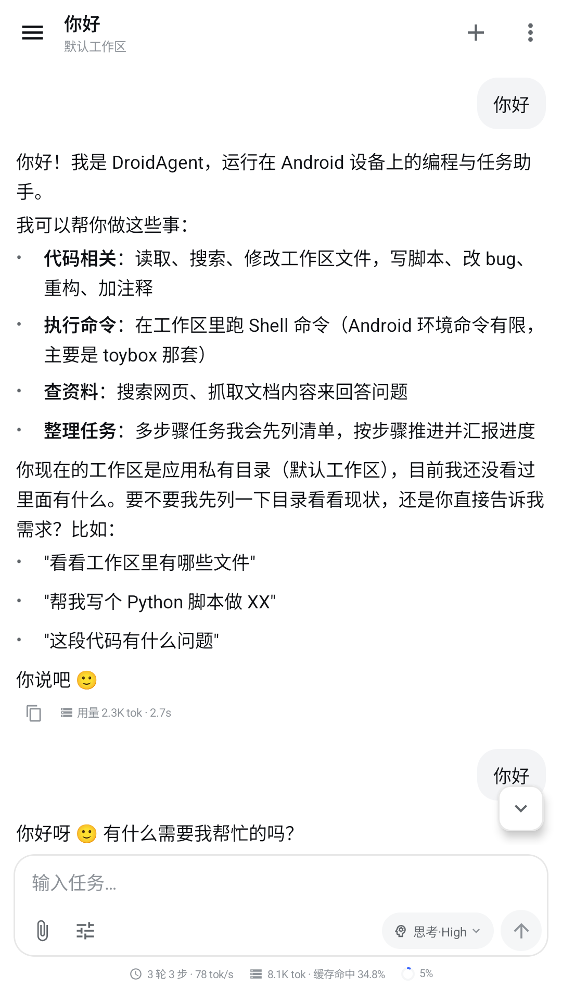
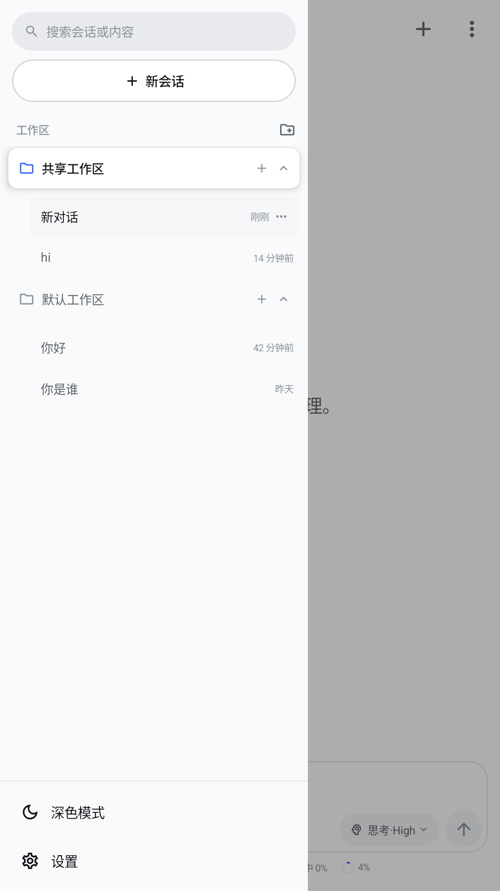
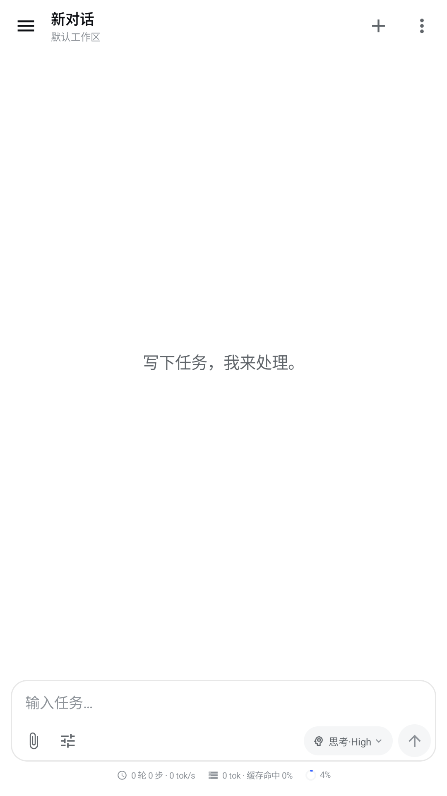
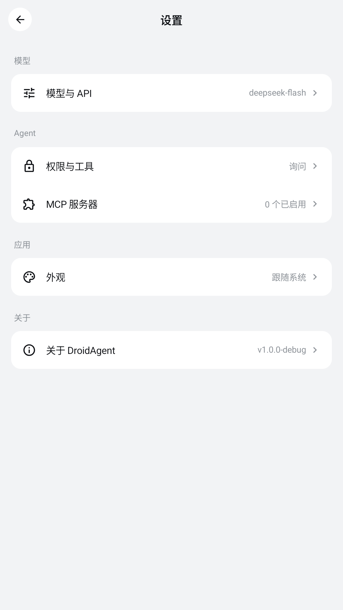

# DroidAgent

[](LICENSE)
[](https://github.com/muzhou07/DroidAgent)
[](https://github.com/muzhou07)

DroidAgent 是一个运行在 Android 上的开源 AI Agent。应用使用 Kotlin 与 Jetpack Compose 原生实现，可以在手机上管理工作区、读写文件、执行 Shell、抓取网页、调用 MCP 工具和启动子代理。

- **作者**：[muzhou07](https://github.com/muzhou07)
- **仓库**：[muzhou07/DroidAgent](https://github.com/muzhou07/DroidAgent)
- **包名**：`com.muzhou.droidagent`
- **系统要求**：Android 8.0（API 26）及以上
- **许可**：MIT

界面与交互参考 DeepSeek 开源的 [chat-demo](https://github.com/deepseek-ai/chat-demo)，Agent 分层设计参考 [deepseek-harness](https://github.com/deepseek-ai/deepseek-harness)，均为 MIT 许可。协议兼容 OpenAI Chat Completions，可用于 DeepSeek、OpenAI、Ollama、LM Studio、vLLM、OneAPI 等服务。

## 截图

| 对话与用量 | 会话与工作区 |
| --- | --- |
|  |  |

| 新对话 | 设置 |
| --- | --- |
|  |  |

截图来自 Android 15 模拟器（1080×1920）。

## 功能

### 对话与模型

- 多会话管理：新建、切换、重命名、删除。
- 启动进入新对话页，并沿用上次使用的工作区；首条消息后由模型生成会话标题。
- 侧栏按工作区分组会话，搜索同时匹配标题与消息内容。
- OpenAI Chat Completions 流式接口，支持 `reasoning_content` 思考内容。
- 工具调用多轮循环，自动累积流式工具参数。
- 重新生成、停止生成、复制回答。
- 思考强度 None / Low / High / Max（默认 High），可在设置与输入区切换，通过 `reasoning_effort` 发送。
- 思考过程自动折叠，仅展开当前推理。
- 请求失败时在会话内显示红色错误消息，并持久化到历史；错误不会发送给模型。
- 请求超时与 12 分钟无活动自动停止，避免长任务卡死。
- 每轮显示 Token 与耗时；输入框下方显示轮数、步数、tok/s、缓存命中与上下文占用。
- 附件支持图片（data URL）与文本/代码文件。
- Markdown 渲染支持标题、列表、引用、表格、链接、行内代码与代码高亮。
- 接近上下文窗口时自动生成摘要，保留最近消息。
- 长会话使用 SQLite WAL、事务写入与后台建项；冷启动无需逐会话统计。
- 向上翻阅历史时显示“回到底部”按钮。
- 深色、浅色、跟随系统主题；设置项实时保存。

### Agent 工具

| 工具 | 能力 | 审批 |
| --- | --- | --- |
| `read_file` | 带行号读取文本，支持 offset/limit | 否 |
| `write_file` | 创建或覆盖文件 | 是 |
| `edit_file` | 精确字符串替换 | 是 |
| `list_dir` | 浏览目录 | 否 |
| `glob` | 按 glob 模式查找文件 | 否 |
| `grep` | 正则搜索文件内容 | 否 |
| `delete_file` | 删除文件或目录 | 是 |
| `run_shell` | 执行 Shell 命令，支持后台任务 | 是 |
| `job_list` | 列出本会话后台任务 | 否 |
| `job_output` | 读取后台任务增量输出 | 否 |
| `job_kill` | 终止后台任务 | 是 |
| `web_search` | DuckDuckGo / Tavily 搜索 | 否 |
| `web_fetch` | 抓取网页并提取正文 | 否 |
| `todo_write` | 更新任务清单 | 否 |
| `task` | 启动子代理 | 否（子代理内部仍审批） |
| `mcp__*` | MCP 服务器提供的工具 | 默认是，`readOnlyHint` 除外 |

### 工作区

- 应用私有工作区：无需额外权限。
- 共享存储工作区：`/sdcard/DroidAgent/`，内置 Shell 与 Termux 均可访问，需要“所有文件访问权限”。
- SAF 工作区：通过系统目录选择器授权；文件工具可用，Shell 取决于路径能否映射为本地路径。
- 会话创建时绑定工作区，之后不可修改。
- 支持工作区创建、删除与在指定工作区新建会话。
- 内置文件管理器、文本编辑器与终端。

### Shell 与 Termux

- 内置 Shell 使用 `/system/bin/sh` 与 toybox，工作目录为工作区根目录。
- Termux 通过 `com.termux.RUN_COMMAND` 执行 bash，适用于共享存储工作区。需要：
  - 安装 Termux，并授予 DroidAgent `RUN_COMMAND` 权限；
  - 在 `~/.termux/termux.properties` 开启 `allow-external-apps=true` 并重启 Termux；
  - 在 Termux 执行 `termux-setup-storage`。
- Shell 返回输出、退出码、耗时与超时状态；超时会终止进程树。
- `run_shell` 支持 `run_in_background=true`，立即返回任务 ID，通过 `job_output`、`job_list`、`job_kill` 管理。

### MCP

- 支持 Streamable HTTP（MCP 2025-03-26）：`initialize`、`tools/list`（分页）、`tools/call`。
- 读取并使用 `Mcp-Session-Id` 与 `MCP-Protocol-Version`，兼容 JSON 与 SSE 响应。
- 服务器支持启用/禁用、请求头配置与连接状态查看。
- 工具名格式为 `mcp__<server>__<tool>`。

### 权限与安全

- 三种权限模式：
  - **询问**：写文件、删除、Shell、MCP 写工具逐次审批，可勾选“本次会话始终允许”。
  - **自动**：全部自动执行，风险较高。
  - **只读**：禁止修改与命令执行。
- 审批面板展示命令、参数与 diff。
- API Key、Tavily Key、自定义请求头与 MCP 请求头使用 Android Keystore（AES/GCM）加密保存；加密失败时不回退为明文。
- `web_fetch` 禁止访问 localhost、内网与保留地址，并通过固定 DNS 解析防止 DNS rebinding；重定向逐跳校验。
- 公网 LLM 服务强制 HTTPS；明文 HTTP 仅允许本机或局域网地址。
- 应用禁用云备份与设备迁移。

### 子代理

- `task` 工具启动独立上下文的子代理，适合代码探索与批量分析。
- 支持两层嵌套，共享工作区、MCP 与审批策略，但对话历史独立。

## 架构

```
app/                     Android UI 与应用层
  ui/chat                聊天、输入区、审批面板、工具卡片
  ui/markdown            Markdown 渲染与代码高亮
  ui/settings            设置主页与子页
  ui/files, ui/terminal  文件管理器、编辑器、终端
  ui/drawer              侧栏会话树
  ui/workspace           工作区选择与创建
  data                   设置、加密、SQLite 会话存储、AgentRunner

agent/                   Android Library，可独立复用
  llm                    OpenAI 兼容客户端（SSE、工具调用、reasoning）
  agent                  Agent Loop、提示词、上下文压缩、Token 估算
  tool                   工具接口与内置工具
  workspace              VFS 抽象：本地文件系统 / SAF
  shell                  内置 Shell / Termux
  mcp                    Streamable HTTP 客户端与管理器
  web                    搜索与网页抓取
```

Agent 循环：

1. 构建系统提示词，包括工作区、权限、任务清单、`AGENTS.md` 项目规则与 MCP 状态。
2. 流式调用模型，累积文本、推理与工具调用参数。
3. 无工具调用时结束；有工具调用时逐个审批并执行。
4. 工具结果写回历史并持久化，进入下一轮。
5. 接近上下文窗口时生成摘要并保留最近消息。

## 构建

### 环境

- JDK 17
- Android SDK：Platform 35、Build Tools 36+
- Gradle 8.9 或项目自带 Wrapper
- Android Studio Ladybug 及以上（可选）

### 命令行

```bash
# local.properties
sdk.dir=/path/to/android-sdk

./gradlew :app:assembleDebug
# APK: app/build/outputs/apk/debug/app-debug.apk
```

发布构建：

```bash
./gradlew :app:assembleRelease
# 已签名: app/build/outputs/apk/release/app-release.apk
# 未配置签名: app/build/outputs/apk/release/app-release-unsigned.apk
```

签名读取仓库根目录的 `keystore.properties`：

```properties
storeFile=release.jks
storePassword=******
keyAlias=droidagent
keyPassword=******
```

`release.jks` 与 `keystore.properties` 已被 `.gitignore` 忽略。缺少配置时自动构建未签名包，便于 CI。请备份密钥与密码，丢失后无法为已安装用户提供覆盖升级。

WSL 示例：

```powershell
wsl -e bash -lc 'export JAVA_HOME=/path/to/jdk17; \
  cd /path/to/DroidAgent && \
  gradle :app:assembleDebug'
```

### 测试

```bash
./gradlew :agent:testDebugUnitTest :app:testDebugUnitTest
```

当前测试覆盖：

- Markdown 解析（标题、列表、表格、未闭合代码块）
- 流式工具调用参数累积
- Glob 匹配与路径穿越防护
- OpenAI 消息序列化（assistant `content: null`、工具调用）
- 多模态消息解析
- 系统提示词与 Token 估算
- `web_fetch` 对 localhost、内网与非 HTTP 协议的拦截

## 使用

1. 打开应用，进入“设置 → 模型与 API”，填写 Base URL、API Key 与模型名。
   - DeepSeek：`https://api.deepseek.com/v1` + `deepseek-flash`
   - OpenAI：`https://api.openai.com/v1` + `gpt-4o`
   - Ollama：`http://<局域网IP>:11434/v1` + 模型名
2. 选择权限模式，首次使用建议“询问”。
3. 在侧栏管理工作区；点击工作区行的 `+` 在该工作区新建会话。
4. 在输入框描述任务，Agent 会按需调用工具并请求审批。
5. 顶栏文件夹图标查看文件，终端图标执行命令。

### MCP 示例

在“设置 → MCP 服务器”添加：

- 名称：`filesystem`
- URL：`https://your-mcp-server.example.com/mcp`
- 请求头：例如 `Authorization: Bearer xxx`

保存后自动连接，工具以 `mcp__filesystem__*` 出现。

## 已知限制

- Android 自带 Shell 为 toybox，`git`、`node`、`python` 等未必存在，可通过 Termux 扩展。
- SAF 目录只有在能映射为本地路径且已授予所有文件权限时才能使用 Shell；文件工具不受影响。
- 图片附件需要模型支持视觉输入。
- 为兼容本地或局域网 LLM 服务，应用允许明文 HTTP；公网服务必须使用 HTTPS。
- 后台长任务受 Android 电池策略限制，建议保持前台运行。
- Termux 需要 `allow-external-apps=true`、共享存储权限与 `RUN_COMMAND` 权限；不满足时回退到内置 Shell。

## 验证

- Android 15 模拟器（1080×1920）完成对话、工具调用、审批、文件写入、Shell、MCP、子代理、附件与网页抓取的端到端测试。
- 本地、共享存储与 SAF 工作区的文件操作和 Shell 可用。
- 冷启动沿用上次工作区；Termux 在共享工作区执行 `echo OK` 返回退出码 0。
- 后台任务 `run_in_background` 与 `job_output(wait=true)` 正常。
- 单元测试通过，`lintDebug` 0 errors，`assembleDebug` 与签名 `assembleRelease` 通过。

## 开发与贡献

- [AGENTS.md](AGENTS.md)：开发指南、代码结构、约束与发布流程。
- [SECURITY.md](SECURITY.md)：安全策略、漏洞报告与已知风险。
- [docs/RELEASE_NOTES_v1.0.0.md](docs/RELEASE_NOTES_v1.0.0.md)：v1.0.0 发布说明。
- [THIRD_PARTY_NOTICES.md](THIRD_PARTY_NOTICES.md)：第三方许可。

## 上游与致谢

- [deepseek-ai/chat-demo](https://github.com/deepseek-ai/chat-demo)（MIT）：界面与交互参考。
- [deepseek-ai/deepseek-harness](https://github.com/deepseek-ai/deepseek-harness)（MIT）：Agent 分层、工具调用、MCP 与工作区设计参考。
- [compose-miuix-ui/miuix](https://github.com/compose-miuix-ui/miuix)（Apache-2.0）：菜单、输入框与滑块风格参考。
- [OkHttp](https://square.github.io/okhttp/)（Apache-2.0）、[kotlinx.serialization](https://github.com/Kotlin/kotlinx.serialization)（Apache-2.0）、[Jsoup](https://jsoup.org/)（MIT）、AndroidX / Jetpack Compose（Apache-2.0）。

DroidAgent 为独立实现，与 DeepSeek 官方无隶属关系。

## 作者

**muzhou07**

- GitHub：<https://github.com/muzhou07>
- 项目主页：<https://github.com/muzhou07/DroidAgent>

## License

[MIT](LICENSE) © 2026 muzhou07
